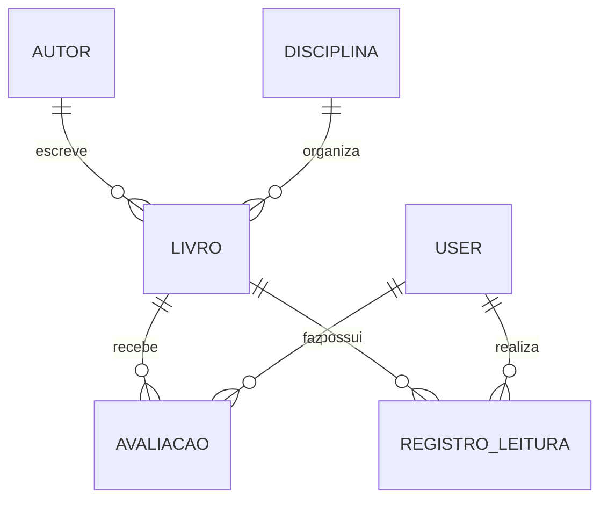

# 📚 API REST - Biblioteca Pública Virtual para Ensino Médio

Backend desenvolvido para a avaliação **NP2** da disciplina de Tecnologia e Programação Web.

O sistema organiza, disponibiliza e permite consultar livros e outros materiais didáticos 100% digitais (livros, apostilas, artigos e resumos em PDF, EPUB ou HTML) para estudantes do ensino médio. Os estudantes podem avaliar os materiais e acompanhar o próprio progresso de leitura.

Repositório: https://github.com/DeathAlt3/biblioteca-virtual

---

## 👥 Equipe e Responsabilidades

| Integrante | GitHub | Responsabilidade |
|---|---|---|
| Alan Sávio Lima Benício | [@DeathAlt3](https://github.com/DeathAlt3) | **Catálogo e Acervo Digital**: projeto base, CRUDs de Autor, Disciplina e Livro/Material Digital, tratamento global de erros, configuração do Swagger e dados iniciais |
| João Victor de Paula Gomes | [@Jv0409](https://github.com/Jv0409) | **Operações e Experiência do Estudante**: CRUDs de Avaliação e Registro de Leitura e a funcionalidade de acompanhamento de progresso de leitura |

---

## 📋 Requisitos

### Funcionais
1. Cadastrar, editar, listar, consultar por ID e excluir **autores**.
2. Cadastrar, editar, listar (filtro por série), consultar por ID e excluir **disciplinas**.
3. Cadastrar, editar, listar (filtros por título, autor ou disciplina), consultar por ID e excluir **livros/materiais digitais**, cada um vinculado a um autor e a uma disciplina.
4. Registrar o acesso a um material e exibir o ranking dos 5 materiais mais acessados.
5. Permitir que o estudante **avalie** um material (nota de 1 a 5, comentário e se recomendaria aos colegas), com no máximo uma avaliação por estudante e material.
6. Permitir que o estudante **inicie uma leitura**, edite seu status (em andamento ou pausada) e consulte seu histórico.
7. **Funcionalidade além do CRUD:** atualizar o progresso de leitura, calculando automaticamente o percentual concluído, o status (concluído ao chegar a 100%) e a estimativa de dias para terminar a leitura de acordo com o ritmo do estudante.

### Não funcionais
- API REST em Java/Spring Boot, organizada nas camadas Model, DTO, Repository, Service e Controller.
- Persistência em banco relacional (H2 em memória por padrão, PostgreSQL opcional).
- Validação de entrada e respostas de erro padronizadas com códigos HTTP adequados.
- Todas as rotas documentadas no Swagger.

---

## 🗂️ Entidades e Relacionamentos

| Entidade (tabela) | Atributos além do ID | Relacionamentos |
|---|---|---|
| **Autor** (`tb_autor`) | nome, nacionalidade, dataNascimento, biografia | 1 autor → N livros |
| **Disciplina** (`tb_disciplina`) | nome (único), areaConhecimento, serie, descricao | 1 disciplina → N livros |
| **Livro** (`tb_livro`) | titulo, isbn, anoPublicacao, numeroPaginas, tipo, formato, urlAcesso, sinopse, totalAcessos, dataCadastro | N livros → 1 autor; N livros → 1 disciplina |
| **Avaliacao** (`tb_avaliacao`) | nota, comentario, dataAvaliacao, recomendariaColegas | N avaliações → 1 usuário; N avaliações → 1 livro |
| **RegistroLeitura** (`tb_registro_leitura`) | dataInicio, dataUltimoAcesso, paginasLidas, percentualConcluido, tempoEstudoMinutos, status, dispositivo | N registros → 1 usuário; N registros → 1 livro |
| User (`tb_user`) — *CRUD da aula, não contabilizado* | name, email, password | representa o estudante |



---

## 🗓️ Cronograma de Desenvolvimento

| Semana | Atividades | Responsável |
|---|---|---|
| 1 | Definição do tema, requisitos e entidades; criação do projeto base (Spring Boot, camadas, User da aula) | Alan e João |
| 2 | Modelagem de Livro, Autor e Disciplina | Alan |
| 3 | CRUDs de Avaliação e Registro de Leitura; funcionalidade de progresso de leitura | João |
| 4 | CRUDs de Autor, Disciplina e Livro; integração com Avaliação e Leitura | Alan |
| 5 | Tratamento global de erros, Swagger, dados iniciais, edição do registro de leitura, README e testes de todas as rotas | Alan (código); testes das rotas: Alan e João |
| 13/11 | Apresentação | Alan e João |

O histórico real de cada contribuição pode ser conferido em `git log` / na aba *Commits* do GitHub.

---

## 🛠️ Tecnologias

* **Java 17+** e **Spring Boot 4.1** (Spring Web MVC, Spring Data JPA)
* **Jakarta Bean Validation** (validação dos DTOs)
* **H2 Database** (em memória, padrão) e **PostgreSQL** (opcional)
* **Lombok** (getters, setters e construtores) e **ModelMapper** (conversão DTO ↔ entidade)
* **SpringDoc OpenAPI 3 / Swagger UI** (documentação)

---

## 🏛️ Camadas da Aplicação

```
backend/src/main/java/br/edu/christus/backend
├── controller/     → Endpoints REST (recebem a requisição, chamam a service) + anotações do Swagger
├── domain/
│   ├── model/      → Entidades JPA (viram tabelas) e enums
│   └── dto/        → Objetos de entrada (RequestDTO, com validações) e saída (ResponseDTO)
├── repository/     → Interfaces JpaRepository (acesso ao banco)
├── service/        → Regras de negócio (404, 409, cálculos, verificações)
├── exception/      → GlobalExceptionHandler e formato padrão de erro (ErroResponse)
├── config/         → OpenApiConfig (Swagger) e DataInitializer (dados de exemplo)
└── util/           → MapperUtil (ModelMapper)
```

Fluxo de uma requisição: **Controller** (valida o DTO com `@Valid`) → **Service** (aplica as regras) → **Repository** (acessa o banco) → **Service** converte a entidade em ResponseDTO → **Controller** devolve o JSON.

---

## 🚀 Como Executar

### Pré-requisitos
* **JDK 17 ou superior** instalado (`java -version`). Não é preciso instalar o Maven: o projeto usa o Maven Wrapper (`mvnw`).

### 1. Clonar o repositório
```bash
git clone https://github.com/DeathAlt3/biblioteca-virtual.git
cd biblioteca-virtual/backend
```

### 2. Iniciar a aplicação (H2 em memória, perfil padrão)
* **Windows (PowerShell / CMD):**
  ```powershell
  .\mvnw.cmd spring-boot:run
  ```
* **Linux / macOS:**
  ```bash
  ./mvnw spring-boot:run
  ```
* **IntelliJ / VS Code:** abra a pasta `backend`, abra `BackendApplication.java` e execute o método `main`.

A API sobe em `http://localhost:8080`. Ao iniciar com o banco vazio, o `DataInitializer` cadastra dados de exemplo:
2 estudantes (IDs 1 e 2), 3 autores, 4 disciplinas e 5 materiais digitais.

> O H2 é em memória: ao parar a aplicação, os dados são apagados e os dados de exemplo são recriados na próxima execução.

* **Console do H2:** http://localhost:8080/h2-console (JDBC URL `jdbc:h2:mem:backend`, usuário `sa`, senha em branco).

### 3. (Opcional) Usar PostgreSQL
Crie o banco `backend` no PostgreSQL (usuário/senha `postgres`, ou ajuste `application-psql.yaml`) e execute:
```bash
./mvnw spring-boot:run -Dspring-boot.run.profiles=psql
```
As tabelas são criadas/alteradas automaticamente pelo Hibernate (`ddl-auto: update`).

---

## 📖 Documentação das Rotas (Swagger UI)

Com a aplicação em execução, acesse: 👉 **http://localhost:8080/swagger-ui.html**
(JSON da especificação OpenAPI: http://localhost:8080/v3/api-docs)

| Recurso | Rotas |
|---|---|
| **Autores** `/api/v1/autores` | `POST` cadastrar · `GET` listar (`?nome=`) · `GET /{id}` · `PUT /{id}` · `DELETE /{id}` |
| **Disciplinas** `/api/v1/disciplinas` | `POST` · `GET` (`?serie=`) · `GET /{id}` · `PUT /{id}` · `DELETE /{id}` |
| **Livros** `/api/v1/livros` | `POST` · `GET` (`?titulo=`, `?autorId=`, `?disciplinaId=`) · `GET /{id}` · `PUT /{id}` · `DELETE /{id}` · `PATCH /{id}/acesso` · `GET /mais-acessados` |
| **Avaliações** `/api/v1/avaliacoes` | `POST` · `GET` (`?livroId=`, `?usuarioId=`) · `GET /{id}` · `PUT /{id}` · `DELETE /{id}` |
| **Registros de Leitura** `/api/v1/leituras` | `POST` iniciar leitura · `GET` (`?usuarioId=`, `?livroId=`) · `GET /{id}` · `PUT /{id}` · `DELETE /{id}` · ⭐ `PATCH /{id}/progresso` |
| Usuários `/api/v1/users` *(aula)* | `POST` · `GET` · `PUT` · `DELETE /{id}` |

⭐ **Funcionalidade além do CRUD — `PATCH /api/v1/leituras/{id}/progresso`:** recebe as páginas lidas e os minutos da sessão; soma o tempo de estudo, calcula o percentual concluído, marca a leitura como `CONCLUIDO` ao chegar a 100% e estima quantos dias faltam para terminar com base no ritmo do estudante (páginas por dia desde o início).

### Padrão das respostas de erro

```json
{
  "timestamp": "2026-11-13T10:15:30",
  "status": 400,
  "erro": "Bad Request",
  "mensagem": "Um ou mais campos estão inválidos. Verifique o objeto 'campos'.",
  "caminho": "/api/v1/livros",
  "campos": { "numeroPaginas": "O número de páginas deve ser maior que zero" }
}
```

| Código | Quando acontece |
|---|---|
| 200 / 201 / 204 | Sucesso (consulta/edição, cadastro, exclusão) |
| 400 | Campo inválido, JSON mal formatado, enum inexistente, regra de negócio (ex: ano no futuro, páginas lidas maiores que o total) |
| 404 | Registro não encontrado pelo ID ou rota inexistente |
| 409 | Conflito: nome/ISBN duplicado, avaliação repetida, leitura já iniciada, exclusão de registro com vínculos |
| 500 | Erro inesperado (detalhes apenas no log do servidor) |

---

## 🧩 Contribuições de cada integrante

**Alan Sávio (@DeathAlt3)**
- Projeto base Spring Boot (estrutura de camadas, User da aula, perfis H2/PostgreSQL).
- Correção do build: dependências de validação e Swagger e H2 como perfil padrão.
- CRUDs completos de **Autor**, **Disciplina** e **Livro/Material Digital** (model, DTOs, repository, service, controller), com relacionamentos, filtros, registro de acesso e ranking dos mais acessados.
- Integração de Livro com as services de Avaliação e Registro de Leitura.
- Tratamento global de erros (`GlobalExceptionHandler`), configuração do Swagger, dados iniciais (`DataInitializer`) e edição (PUT) do Registro de Leitura.
- Atualização deste README.

**João Victor de Paula Gomes (@Jv0409)**
- CRUD completo de **Avaliação/Resenha**.
- CRUD de **Registro de Leitura** e a funcionalidade de **acompanhamento de progresso** (cálculo de percentual, status e estimativa de dias).
- Primeira versão da documentação (README).

---

## 🤖 Registro do Uso de Inteligência Artificial

| Integrante | Ferramenta | Para que foi usada | Como o resultado foi verificado |
|---|---|---|---|
| Alan | Claude (Anthropic), no app Claude/Cowork | Revisar o projeto em relação aos requisitos da NP2, apontar o que faltava (build quebrado, CRUDs ausentes, tratamento de erros) e gerar uma primeira versão do código de Autor, Disciplina, Livro, `GlobalExceptionHandler`, `DataInitializer` e do README | Leitura e revisão de cada arquivo; execução do projeto com `mvnw spring-boot:run`; teste manual de todas as rotas no Swagger (casos de sucesso e de erro 400/404/409) |
| João | *(preencher: ferramenta, para que usou e como verificou)* | | |

---

## 📦 Versão entregue

* Repositório: https://github.com/DeathAlt3/biblioteca-virtual
* Commit da versão entregue: informado no arquivo de entrega do Moodle (último commit da branch `main` no momento da entrega).
